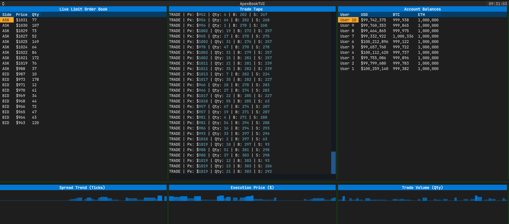

# ApexBook

ApexBook is an ultra-low latency, zero-allocation limit order book engine written in Modern C++ (C++20), paired with a powerful Python Textual Dashboard (TUI) for real-time market data visualization.

Inspired by industry-standard High-Frequency Trading (HFT) architectures, this project completely bypasses standard `std::mutex` bottlenecks and `std::priority_queue` allocations. Instead, it utilizes lock-free single-producer single-consumer (SPSC) ring buffers, intrusive doubly-linked lists, and hardware timestamp counters (`rdtsc`) to execute order matches in ~200 nanoseconds.

## System Architecture

```text
  [ Python TUI / SDK (Textual Dash) ]
                 ^
                 | (JSON via stdout)
                 |
+-----------------------------------------------------------------+
|                       ApexBook C++ Core                         |
|                                                                 |
|   +------------------+                 +--------------------+   |
|   |                  |  Inbound SPSC   |   Engine Manager   |   |
|   |  Gateway Thread  |===============> |  (Pinned Thread)   |   |
|   |  (Risk & Limits) |                 +---------+----------+   |
|   +------------------+                           |              |
|                                                  | Order        |
|                                                  v              |
|   +------------------+                 +--------------------+   |
|   |   MDP Thread     |  Outbound SPSC  |   Core OrderBook   |   |
|   | (Event Sourcing) |<=============== | (O(1) Memory Pool) |   |
|   +---------+--------+                 +--------------------+   |
|             |                                                   |
+-------------|---------------------------------------------------+
              v
     [ apex_journal.bin (mmap) ]
```

### Core Components:
1. **Core Matching Engine (`OrderBook`)**: Maintains $O(1)$ order insertions and cancellations using a pre-allocated `OrderPool` and price-level hash maps mapped to custom doubly-linked lists.
2. **Lock-Free Concurrency**: Leverages C++20 `std::atomic` operations with 64-byte alignment to prevent false sharing cache misses when passing messages across threads.
3. **Pre-Trade Risk Manager**: Validates account balances and perfectly locks/settles Quote and Base currencies inside the pipeline before hitting the execution engine.
4. **Zero-Copy Event Sourcing**: The Market Data Publisher (MDP) thread persists execution streams directly to a binary file via Unix `mmap`.

## Live Terminal Dashboard (TUI)

We provide a production-grade, highly responsive terminal dashboard built using Python's `Textual`.



### Features:
- **Live Limit Order Book**: Depth chart split by Bids (Green) and Asks (Red).
- **Time & Sales Tape**: A scrolling log of executed trades detailing price, size, and counter-party IDs.
- **Account Balances**: Matrix tracking live user funds (USD, BTC, ETH) as they execute trades.
- **Real-Time Sparklines**: Bottom row tracks Spread Trends, Execution Prices, and Trade Volumes animated per tick.

## Build Instructions

**Dependencies:**
- GCC / G++ (C++20 support)
- CMake
- Python 3.10+ (for TUI)

### 1. Build the C++ Core
```bash
mkdir build && cd build
cmake ..
make -j4
```

### 2. Run the Benchmark Engine
```bash
./build/benchmark_engine
```
*Note: Run with a Release build (`-O3 -DNDEBUG`) to see sub-50 nanosecond execution latency.*

### 3. Launch the Trading Dashboard (TUI)
```bash
cd python
pip install -r requirements.txt
python tui.py
```
*(The dashboard will automatically spawn the C++ backend as an async subprocess and pipe the output into the GUI).*
